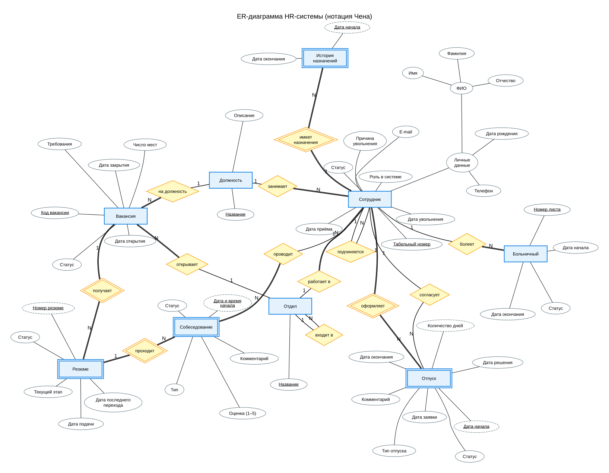
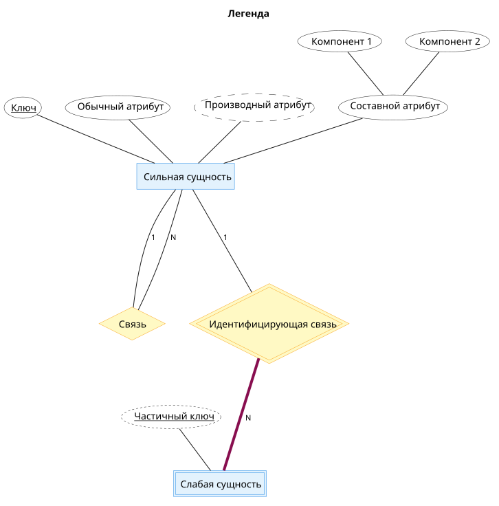

# Этап 2. Концептуальное проектирование

## Cхема в нотации Чена

(можно нажать для детального просмотра)
[](https://raw.githubusercontent.com/SpideErik/db_basic/prj-01/prj_01/docs/assets/img/sch.svg)

### Легенда

```
Тонкая линия — частичное участие, жирная бордовая — полное участие. 
Цифры 1 и N у линии — кардинальность связи.
У рекурсивных связей линия N идёт от подчинённого (дочернего), линия 1 от руководителя (родительского).
```

| Обозначение | Что значит |
|---|---|
| Прямоугольник | Сильная сущность |
| Двойной прямоугольник | Слабая сущность |
| Ромб | Связь |
| Двойной ромб | Идентифицирующая связь |
| Овал с подчёркиванием | Ключевой атрибут |
| Пунктирный овал с подчёркиванием  | Частичный ключ слабой сущности |
| Пунктирный овал | Производный атрибут |
| Овал с овалами | Составной атрибут |
| Жирная бородовая линия | Полное участие |

## Классификация

Для первого шага я разделил сущности на сильные и слабые по критерию Чена: сильная сущность имеет собственный ключ, слабая идентифицируется только через владельца.

| Сущность | Тип | Обоснование |
|---|---|---|
| Отдел | Сильная | Уникальное название |
| Должность | Сильная | Уникальное название |
| Сотрудник | Сильная | Уникальный табельный номер и e-mail |
| Вакансия | Сильная | Существует сама по себе, создаётся HR |
| Больничный | Сильная | Уникальный номер листа, поэтому собственный ключ есть |
| Отпуск | Слабая | Собственного ключа нет, идентифицируется как Сотрудник + Дата начала |
| История назначений | Слабая | Идентифицируется как Сотрудник + Дата начала |
| Резюме | Слабая | Номер резюме уникален только в паре с Вакансией |
| Собеседование | Слабая | Идентифицируется как Резюме + Дата и время начала |

## Сущности и атрибуты

| Сущность | Тип | Атрибуты (ключевые подчёркнуты) |
|---|---|---|
| Отдел | Сильная | <u>Название</u> |
| Должность | Сильная | <u>Название</u>, Описание |
| Сотрудник | Сильная | <u>Табельный номер</u>, Фамилия, Имя, Отчество, Дата рождения, Телефон, E-mail, Роль в системе, Дата приёма, Дата увольнения, Причина увольнения, Статус |
| Больничный | Сильная | <u>Номер листа</u>, Дата начала, Дата окончания, Статус |
| Вакансия | Сильная | <u>Код вакансии</u>, Число мест, Требования, Дата открытия, Дата закрытия, Статус |
| Отпуск | Слабая | <u style="text-decoration: underline dashed">Дата начала</u>, Тип отпуска, Дата окончания, Количество дней, Статус, Дата заявки, Дата решения, Комментарий |
| История назначений | Слабая | <u style="text-decoration: underline dashed">Дата начала</u>, Дата окончания |
| Резюме | Слабая | <u style="text-decoration: underline dashed">Номер резюме</u>, Дата подачи, Текущий этап, Статус, Дата последнего перехода |
| Собеседование | Слабая | <u style="text-decoration: underline dashed">Дата и время начала</u>, Тип, Статус, Оценка (1–5), Комментарий |

Пояснения:

1. **Сплошное подчёркивание** означает ключ сильной сущности, **пунктирное** означает частичный ключ слабой сущности. Полный идентификатор слабой сущности составляется вместе с ключом владельца. Например, у отпуска это Табельный номер сотрудника + Дата начала. 
2. **Атрибуты-ссылки** (Отдел, Должность, Руководитель, Родительский отдел, Согласовал, Вакансия, Резюме, Сотрудник) в нотации Чена атрибутами не рисуются. Они превращаются в связи (ромбы), поэтому в таблицу не вошли.
3. **Количество дней** у отпуска можно вычислить по датам. В нотации Чена его можно нарисовать как производный атрибут (овал с пунктирной границей).


## Описание связей

| Связь | Сущности | Тип | Смысл | Обоснование типа |
|---|---|---|---|---|
| работает в | Отдел — Сотрудник | 1:N | Один отдел включает много сотрудников; каждый сотрудник относится ровно к одному отделу | Не 1:1: в отделе работает много людей. Не M:N: по ограничению этапа 1 сотрудник в каждый момент времени относится ровно к одному отделу. Прошлые отделы хранит «История назначений» |
| занимает | Должность — Сотрудник | 1:N | Одну должность занимает много сотрудников; каждый сотрудник занимает ровно одну должность | Не 1:1: должность «Менеджер» есть у многих. Не M:N: сотрудник занимает одну должность на момент времени (процесс «Приём сотрудника») |
| подчиняется (рекурсивная) | Сотрудник (подчинённый) — Сотрудник (руководитель) | 1:N | Один руководитель имеет много подчинённых; у каждого сотрудника не более одного непосредственного руководителя | Не 1:1: у руководителя несколько подчинённых. Не M:N: иерархия подчинения строится как дерево. Участие частичное: у руководителя верхнего уровня руководителя нет |
| входит в (рекурсивная) | Отдел (дочерний) — Отдел (родительский) | 1:N | Один отдел содержит много дочерних отделов; каждый дочерний отдел входит не более чем в один родительский | Не 1:1: у отдела может быть несколько подотделов. Не M:N: отдел не может подчиняться двум родителям. Участие частичное: у корневого отдела родителя нет |
| болеет | Сотрудник — Больничный | 1:N | Один сотрудник может иметь много больничных за всё время; каждый больничный относится ровно к одному сотруднику | Не 1:1: за год у сотрудника бывает несколько больничных. Не M:N: больничный лист выдан одному человеку (процесс «Оформление больничного») |
| оформляет (идентифицирующая) | Сотрудник — Отпуск | 1:N | Один сотрудник имеет много отпусков; каждый отпуск принадлежит ровно одному сотруднику | Не 1:1: отпуска берутся многократно. Не M:N: заявка подаётся одним сотрудником. Отпуск без сотрудника существовать не может, поэтому он слабая сущность, а связь идентифицирующая |
| согласует | Сотрудник (согласующий) — Отпуск | 1:N | Один сотрудник (руководитель или HR) согласует много заявок; у каждого отпуска не более одного согласовавшего | Не 1:1: руководитель решает по заявкам многих подчинённых. Не M:N: решение по заявке принимает один человек. Участие частичное: у заявки в статусе «заявлен» согласующего ещё нет |
| имеет назначения (идентифицирующая) | Сотрудник — История назначений | 1:N | Один сотрудник имеет много записей истории; каждая запись относится ровно к одному сотруднику | Не 1:1: сотрудника переводят несколько раз. Не M:N: запись описывает путь одного человека. Запись не существует без сотрудника, поэтому связь идентифицирующая |
| открывает | Отдел — Вакансия | 1:N | В одном отделе открывается много вакансий; каждая вакансия относится ровно к одному отделу | Не 1:1: отдел набирает людей многократно. Не M:N: вакансия открывается под нужды одного отдела (процесс «Открытие вакансии») |
| на должность | Должность — Вакансия | 1:N | На одну должность открывается много вакансий; каждая вакансия объявлена ровно на одну должность | Не 1:1: должность может понадобиться в разное время и в разных отделах. Не M:N: вакансия описывает одну позицию |
| получает (идентифицирующая) | Вакансия — Резюме | 1:N | На одну вакансию поступает много резюме; каждое резюме подано ровно на одну вакансию | Не 1:1: на вакансию откликаются многие (в среднем около 40). Не M:N: в модели резюме идентифицируется парой «номер + вакансия», то есть отклик на другую вакансию считается отдельной записью. Поэтому Резюме слабая сущность |
| проходит (идентифицирующая) | Резюме — Собеседование | 1:N | Резюме проходит несколько собеседований (скрининг, техническое и т. д.); каждое собеседование относится ровно к одному резюме | Не 1:1: этапов воронки с собеседованием может быть несколько. Не M:N: собеседование проводится по одному резюме. Участие частичное со стороны резюме: до этапа собеседования их ещё нет |
| проводит | Сотрудник (интервьюер) — Собеседование | 1:N | Один сотрудник проводит много собеседований; у каждого собеседования ровно один интервьюер | Не 1:1: руководители участвуют в собеседованиях регулярно. Не M:N: по модели у собеседования один интервьюер. Участие частичное со стороны сотрудника: большинство сотрудников собеседований не проводят |

Замечания:

1. Связей M:N в схеме нет. Это нормально: данные уже приведены к виду, где каждая связь «один ко многим», и промежуточные таблицы не нужны.
2. Между Сотрудником и Отпуском две связи, «оформляет» (чей отпуск) и «согласует» (кто решил). Роли в таблице указаны в скобках, чтобы их не путали.


## Слабые сущности

| Сущность | От чего зависит | Почему слабая | Ключ |
|---|---|---|---|
| Отпуск | Сотрудник (связь «оформляет», двойной ромб) | У отпуска нет собственного уникального атрибута: даты и тип повторяются у разных людей. Без сотрудника заявка не существует (структурное ограничение этапа 1: отпуск связан с существующим сотрудником). Один сотрудник не может иметь два пересекающихся отпуска (Б1), поэтому дата начала однозначно выделяет отпуск внутри сотрудника | Составной: Табельный номер (ключ родителя) + Дата начала (частичный ключ) |
| История назначений | Сотрудник (связь «имеет назначения», двойной ромб) | Запись описывает отрезок пути одного сотрудника: отдел, должность, руководителя с датами. Вне сотрудника она не имеет смысла. В один момент у сотрудника одно назначение, поэтому дата начала различает записи | Составной: Табельный номер (ключ родителя) + Дата начала (частичный ключ) |
| Резюме | Вакансия (связь «получает», двойной ромб) | Номер резюме приходит из внешнего источника и уникален только в паре с вакансией (этап 1: «одно и то же резюме подаётся на вакансию один раз»). Данные кандидата не хранятся, поэтому отклик на другую вакансию считается отдельной записью | Составной: Код вакансии (ключ родителя) + Номер резюме (частичный ключ) |
| Собеседование | Резюме (связь «проходит», двойной ромб) | Собеседование не существует без резюме (структурное ограничение этапа 1). Одно резюме не может участвовать в двух собеседованиях одновременно (Б-правило этапа 1), поэтому дата и время начала различают собеседования внутри резюме | Составной: Код вакансии + Номер резюме (ключ родителя, он сам составной) + Дата и время начала (частичный ключ) |

На диаграмме все четыре сущности нарисованы двойными прямоугольниками, их идентифицирующие связи («оформляет», «имеет назначения», «получает», «проходит») двойными ромбами. Частичные ключи показаны подчёркиванием и пунктирным овалом. Graphviz не умеет рисовать двойное подчёркивание, поэтому различие передано контуром, это стоит указать в подписи к схеме.

Сильные сущности: Отдел, Должность, Сотрудник, Вакансия, Больничный. У каждой есть собственный ключ. Больничный сильный, потому что номер листа уникален глобально (этап 1), хотя без сотрудника больничный тоже не бывает: ссылка на владельца есть, но для идентификации она не нужна.

Собеседование зависит ещё и от сотрудника-интервьюера, но эта связь («проводит») не идентифицирующая: интервьюер в ключ не входит.

## Атрибуты связей

Все связи на диаграмме имеют тип 1:N, а у связи 1:N собственных атрибутов быть не должно: они относятся к стороне «N». Поэтому ромбы на схеме без атрибутов. Там, где в этапе 1 есть «атрибуты события», событие выделено в самостоятельную сущность. Основной пример: «Собеседование». Его можно было бы увидеть как связь M:N «Резюме — Сотрудник (интервьюер)» с атрибутами дата, тип, статус, оценка, комментарий. Но тогда у ромба не было бы ключа, а одна пара «резюме + интервьюер» могла бы встречаться несколько раз (скрининг и техническое собеседование). Ромб не может иметь ключ и участвовать в других связях, поэтому атрибуты перенесены в сущность «Собеседование», а исходная M:N заменена двумя связями 1:N («проходит» и «проводит»).

| Атрибут (из этапа 1) | Где хранится | Почему не на связи |
|---|---|---|
| Дата и время начала, Тип, Статус, Оценка (1–5), Комментарий | Собеседование | Свойства конкретного факта собеседования, а не резюме и не интервьюера. У одной пары «резюме + интервьюер» собеседований может быть несколько, поэтому на ромбе их не отличить |
| Дата начала, Дата окончания (назначения) | История назначений | Исходно это связь M:N «Сотрудник — Отдел/Должность» с датами. Она заменена сущностью, так как у назначения есть три ссылки (отдел, должность, руководитель), а сотрудник может вернуться в тот же отдел позже |
| Дата решения, Комментарий (решение по отпуску) | Отпуск | Связь «согласует» 1:N, поэтому атрибуты уходят на сторону N. Решение принадлежит конкретной заявке, а не согласующему |
| Согласовал | Отпуск (ссылка на Сотрудника) | Это сама связь «согласует», у неё нет своих атрибутов, а решение хранится в отпуске |
| Дата подачи, Текущий этап, Статус, Дата последнего перехода | Резюме | Свойства отклика на конкретную вакансию. Связь «получает» 1:N, атрибуты хранятся на стороне N |

Остальные связи («работает в», «занимает», «подчиняется», «входит в», «болеет», «открывает», «на должность», «оформляет», «проходит», «проводит») атрибутов не имеют: это чистые ссылки между сущностями.

Для таких связей M:N не возникает, поэтому «Собеседование» и «История назначений» остаются самостоятельными сущностями. Если преподаватель спросит, почему нет связей M:N, можно ответить именно этим: каждая потенциальная M:N содержит собственные атрибуты и ссылки на третьи сущности, поэтому преобразована в сущность с двумя связями 1:N.

## Замечания о M:N

В схеме нет ни одной связи M:N, нарисованной напрямую. Но в предметной области есть две исходные M:N, которые сразу заменены сущностями:

- **Резюме — Сотрудник (проводит собеседование).** Одно резюме проходит несколько собеседований у разных интервьюеров, а один сотрудник проводит собеседования по многим резюме.
- **Сотрудник — Отдел / Должность (назначение во времени).** За всё время сотрудник работал в нескольких отделах и должностях, а в одном отделе или должности работало много сотрудников.

| Исходная M:N | Чем заменена | Преобразование на этапе 3 |
|---|---|---|
| Резюме — Сотрудник (проводит собеседование) | Резюме — Собеседование (1:N, «проходит») + Сотрудник — Собеседование (1:N, «проводит») | FK «Резюме» (Код вакансии + Номер резюме) и FK «Интервьюер» (на Сотрудника) в таблице «Собеседование» |
| Сотрудник — Отдел / Должность (назначение) | Сотрудник — История назначений (1:N, «имеет назначения»); связи с Отделом, Должностью и руководителем упрощены на диаграмме, на этапе 3 это FK | FK «Сотрудник», «Отдел», «Должность», «Руководитель» (на Сотрудника) в таблице «История назначений» |

«Собеседование» станет таблицей с суррогатным ключом (ID собеседования), а не составным (резюме + дата и время). Одна пара «резюме + интервьюер» может повторяться (скрининг и техническое собеседование), поэтому пара не годится в ключ. Запрет на два одновременных собеседования (у интервьюера и у резюме) реализуется на этапах 4–5 (EXCLUDE или триггер). Для «Истории назначений» ключом остаётся пара «сотрудник + дата начала», а запрет пересекающихся назначений тоже решается на этапах 4–5.

Прочих M:N-связей в модели нет: остальные связи 1:N реализуются напрямую внешними ключами на стороне N.

## Итог по этапу 2:

9 сущностей (4 слабые), 13 связей (4 идентифицирующие, 2 рекурсивные), 0 прямых M:N-связей, 2 потенциальные M:N преобразованы в сущности «Собеседование» и «История назначений». Ключи совпадают с этапом 1: табельный номер, название отдела, название должности, номер листа;
